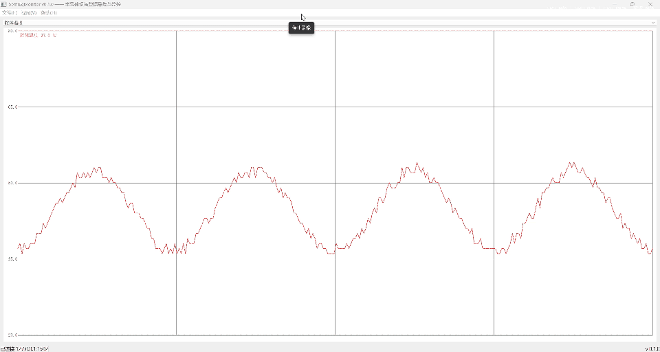
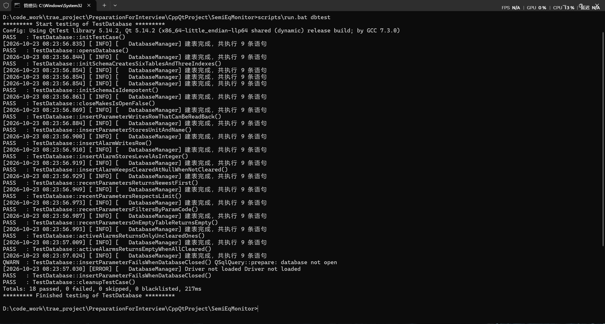
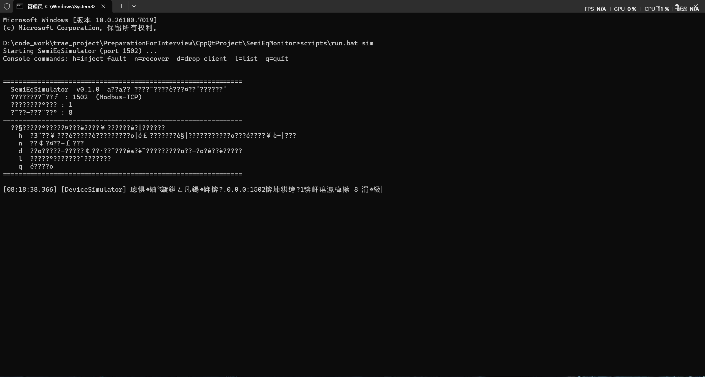
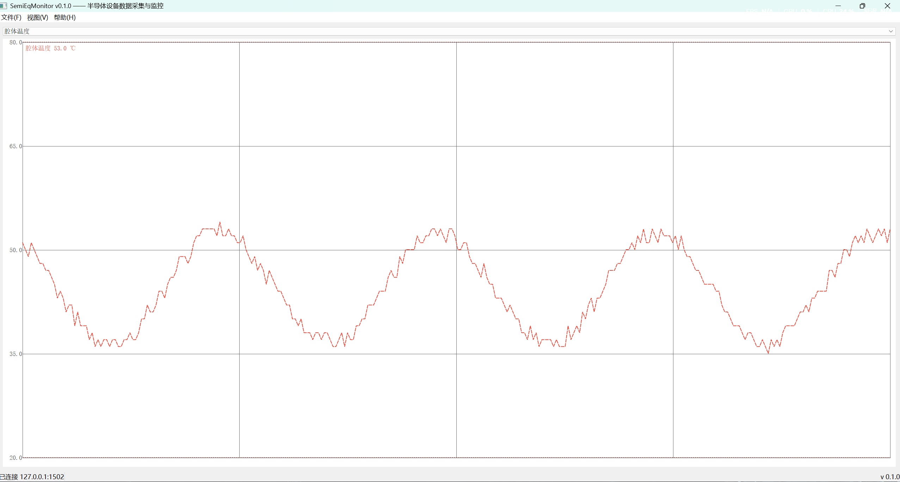

# SemiEqMonitor

> 半导体设备数据采集与监控上位机 ｜ **C++11 / Qt 5.14 / SQLite / Modbus-TCP**
> 状态：**v0.7（落库版）** · 8 路参数实时采集 → 曲线 → **落库**全链跑通 · 采集**已线程化**、数据**实时入库** · 报警引擎 / SPC 在规划中

面向半导体与泛半导体制造设备的**上位机监控软件**：定时轮询设备寄存器、解析工程量、
自绘实时曲线、数据落库与查询。

配套一个**独立的设备模拟器**（`SemiEqSimulator`），因此**无需任何真实硬件**即可完整演示与复现。



> 上图：连接模拟器后，8 路参数按 500ms 周期刷新，曲线随窗口自适应缩放（规格上下限为虚线）。

---

## 1. 这个项目解决什么

半导体设备（AOI/SPI/AXI 检测机、测试机）的软件通常分两层：

- **设备侧**：控制运动、采集传感器、执行测试
- **上位机（HMI）**：连接设备、展示数据、判定与报警、落库与查询

本项目实现**上位机侧**，用模拟器扮演设备侧。

**目标岗位**：设备软件 / 上位机 / 机器视觉方向。
刻意覆盖这类 JD 的公共技术点 —— **Modbus 协议、TCP 粘包拆包、Qt 信号槽与自绘、
SQLite 持久化、分层架构与接口抽象**。

---

## 2. 功能清单

### ✅ 已实现

| 模块 | 内容 |
|---|---|
| **通信** | Modbus-TCP 客户端：0x03 读保持寄存器，**请求帧组帧 / 响应帧解析 / 异常响应识别**（MBAP 7 字节头 + 事务标识回显校验） |
| **可靠性** | 接收缓冲**三步法**处理**粘包 / 拆包**；**in-flight 标志**防止请求堆积；连接超时保护（单次定时器 + abort） |
| **采集** | QTimer 500ms 轮询 8 个寄存器；解析后按通道配名称/单位/上下限/时间戳 |
| **采集线程化** | `moveToThread` 把 `ModbusTcpClient`（含 `QTcpSocket`）搬入工作线程；UI 线程只发信号（`connectRequested` / `disconnectRequested`），跨线程走 `QueuedConnection` 由工作线程执行；析构 `quit() + wait()` 安全收尾；`QThread::finished → deleteLater` 回收客户端 |
| **逐通道量化** | 每通道独立 `scale`（0.01 / 0.001 / 0.0001 …）：设备侧 `round(工程量 / scale)`、上位机 `原值 × scale` 还原；替换掉"16 位寄存器直接截断小数"的旧做法 |
| **实时曲线** | `QPainter` 纯代码自绘：绘图区计算 / 量程自适应 / 网格与坐标轴刻度 / 规格上下限虚线 / 通道折线 / 图例；**抗锯齿**、任意窗口尺寸缩放 |
| **持久化** | SQLite：**6 表 3 索引**、幂等建表、事务写入；**采集数据实时落库**（`insertParameters()` 一个事务批量写，实测 78 秒写 1248 行、8 通道）；参数/报警的增删改查由 **18 个单元测试**覆盖 |
| **设备模拟器** | 独立可执行程序：Modbus-TCP 服务端、8 路参数（正弦 + 噪声）、控制台故障注入（超温 / 断线等） |
| **界面** | 纯代码构建主窗口（无 `.ui`）：菜单栏 / 状态栏 / 中央区 / 关于框；连接状态实时显示 |
| **测试** | **18 个单元测试全绿**（协议解析 + 良率计算）＋ `dbtest` **18 passed / 0 failed** |

### 🚧 规划中（尚未实现，不要当成已有能力）

| 内容 | 计划 |
|---|---|
| **生产者-消费者队列** | 采集已在线程里跑，但**还没有**跨线程队列缓冲（当前靠 `m_waitingResponse` 做请求保护） |
| **Modbus-RTU / 串口** | `IDeviceClient` 已预留扩展点，`ModbusRtuClient` **尚未实现** |
| **报警引擎** | 目前只有上下限字段与落库能力，**阈值判定 + 持续时间 + 界面提示未做** |
| **数据表格** | `QAbstractTableModel` 未实现 |
| **SPC / 良率报表 / Wafer Map / MES 对接** | 未开始 |

---

## 3. 架构（当前真实实现）

```
┌───────────────────────────── UI 线程 ─────────────────────────────────┐
│  MainWindow                                                            │
│  菜单 / 状态栏 / 实时曲线（QPainter 自绘）／参数下拉                    │
│                                                                        │
│  QTimer(500ms) ──timeout──┐          emit connectRequested ──┐         │
└───────────────▲───────────┼──────────────────────────────────┼─────────┘
                │           │  QueuedConnection（排队投递）      │
                │ 参数批量    ▼                                  ▼
┌───────────────┴────────────────── 采集工作线程 ───────────────────────┐
│  m_acqThread（QThread）                                                │
│  ModbusTcpClient  ← moveToThread（**无 parent**）                      │
│  IDeviceClient 抽象接口的唯一实现（RTU 预留）                           │
│   · 组帧 / 解析 / 粘包拆包 / 超时 / in-flight 保护                     │
│   · QTcpSocket 在【本线程】收发                                        │
│  QThread::finished → deleteLater（客户端在自己的线程被回收）           │
└───────────────────────────────┬────────────────────────────────────────┘
                                │ Modbus-TCP（127.0.0.1:1502）
┌───────────────────────────────▼────────┐   ┌──────────────────────────┐
│  SemiEqSimulator（独立程序）            │   │  SQLite                  │
│  8 路参数（正弦+噪声）· 控制台故障注入   │   │  6 表 3 索引 · 事务       │
│  h=超温 n=恢复 d=断线 l=列表 q=退出     │   │  采集数据实时落库（批量事务）│
└────────────────────────────────────────┘   └──────────────────────────┘
```

> 🔴 **线程边界只有两处**：① UI 线程 `emit` 命令信号 → 工作线程执行槽；② 工作线程 `emit parametersRead` → 排队回 UI 线程更新曲线。**UI 线程从不直接调用 `m_client` 的成员函数**（`isConnected()` / `endpoint()` 两个只读查询除外，见 §8）。

**两条关键设计**

| 设计 | 说明 |
|---|---|
| **`IDeviceClient` 抽象接口** | 让"数据从哪来"与"业务怎么用"解耦。UI 只依赖接口（`isConnected()` / `isConnecting()` / `endpoint()`），**不依赖 `QTcpSocket`**；换成串口实现时 UI 一行不用改 |
| **设备模拟器独立成程序** | 扮演设备侧、不依赖上位机代码。既解决"没有真实硬件"，也让**任何人都能完整复现演示** |

---

## 4. 技术难点与解决（真实踩过的坑）

### 4.1 粘包 / 拆包

TCP 是字节流，一次 `readyRead` 可能只收到半帧，也可能一次收到两帧。

**做法**：`readAll()` → 追加进累积缓冲 → 不足一帧长度就 return 等下次（拆包）→
够一帧就 `while` 循环切出、解析，剩余字节留在缓冲（粘包）。
帧长由协议推出：**MBAP 7 + 功能码 1 + 字节数 1 + 8×2 = 25 字节**。

### 4.2 请求堆积保护

轮询周期 500ms，若设备慢于 1s 不响应，下一轮请求会叠加。

**做法**：`m_waitingResponse` 标志——上一帧未回则本轮直接跳过，收到响应或出错时清除。

### 4.3 16 位寄存器 vs 小数工程量

Modbus 寄存器是 `uint16`，**传不了小数**。直接 `static_cast<quint16>(value)` 会截断：

| 通道 | 实际 | 发出 | 后果 |
|---|---|---|---|
| 温度 | 45.6 | 45 | 量程 20–80，看不出 |
| 压力 | 100.3 | 100 | 量程 90–120 → 曲线呈阶梯 |
| **真空度** | **0.6** | **0** | 量程 0–1 → **全丢，恒为 0** |

**做法（v0.6 已落地：逐通道 scale）**：

```
设备侧：寄存器原值 = round(工程量 / scale)      // 四舍五入，不是截断
上位机：工程量     = 寄存器原值 × scale
```

8 个通道的 scale 各不相同（`0.01 / 0.01 / 0.001 / 1 / 0.1 / 0.0001 / 0.01 / 0.001`），
见 `docs/协议说明.md` §3。**为什么必须逐通道**：8 路量纲差 5 个数量级（真空度 0~1 kPa vs 转速 0~3000 rpm），
用同一个因子必然有一头被量化吃光。**选取原则**：让「量程上限 / scale」落在 **8k–16k counts**，
既留足 16 位（65535）余量又不浪费分辨率。

> 🔴 三处必须同步：`docs/协议说明.md` §3 表 / `devicesimulator::registerScales()` / `mainwindow::defaultChannels()`
> （已记为 `BUGS.md` TODO-0005：目前靠人工维护，无自动校验）

### 4.4 Qt / C++ API 的两个静默陷阱
| 陷阱 | 现象 | 正解 |
|---|---|---|
| **返回临时对象的引用** | `const QString& endpoint() { return QStringLiteral("%1:%2").arg(...); }` → 悬垂引用（GCC `-Wreturn-local-addr`），**能编译能跑**但结果未定义 | `const&` 只能返回成员/静态/入参；**现场算出来的必须按值返回**（C++17 RVO 零拷贝） |
| **`QString::arg` 的重载** | `.arg(host, port)` 里 `port` 被当成**字段宽度**（补了 1502 个空格），`%2` 没被替换 | 多值必须链式 `.arg(host).arg(port)`；`int` 的第二参是进制、`double` 是格式、`QString` 是宽度 |

### 4.5 采集线程化：三个会静默失败的坑（v0.6）

| 坑 | 现象 | 正解 |
|---|---|---|
| **带 parent 的对象不能 moveToThread** | `QObject::moveToThread: Cannot move objects with a parent`，然后**程序照跑、还在 UI 线程** —— 最坑的是不崩 | `new ModbusTcpClient(cfg)` **不给 parent**；配置（`setParameters`）必须在 move **之前**完成 |
| **跨线程直接调 socket 成员函数** | `QSocketNotifier: Socket notifiers cannot be enabled or disabled from another thread`，**连不上** | 跨线程只能用「信号 → 槽」：UI 线程 `emit connectRequested()`，槽 `ModbusTcpClient::connectToDevice` 在工作线程执行。<br>⚠️ 不要在 `MainWindow` 里再写一个中转槽——**槽在哪个对象里，就在哪个对象的线程执行**，中转槽仍在 UI 线程，等于白转 |
| **析构不 quit + wait** | 关窗口报 `QThread: Destroyed while thread is still running` 然后 `abort()` | 析构里 `if (m_acqThread) { quit(); wait(); }`；另配 `QThread::finished → m_client->deleteLater`，让客户端在自己的线程被回收 |

**为什么 `poll` 不用额外造信号**：它由 `QTimer::timeout` 驱动，**本身就有信号**可搭。
而「连接/断开」的发起者是**鼠标点击**（`QAction::triggered` → `onConnectDevice` 槽，那一棒已经把信号用掉了），
到 `m_client` 这第二棒手上没有信号可用 → 必须自己声明 `connectRequested` / `disconnectRequested`。

---

## 5. 测试与验证

| 项 | 结果 |
|---|---|
| 协议层单元测试 | **18 passed / 0 failed**（组帧、解析、异常响应、字节序） |
| 持久层测试 `dbtest` | **18 passed / 0 failed**（建表幂等、事务、读写、索引） |
| 端到端联调 | 模拟器 ↔ Modbus-TCP ↔ 客户端，**25 字节响应帧校验通过** |
| 曲线验证 | 8 条通道同时刷新，500ms 采样，规格线 80/20 与实际值对照正常 |



---

## 6. 目录结构

```
SemiEqMonitor/
├── CMakeLists.txt                顶层构建（4 个目标）
├── README.md / CHANGELOG.md / DEVLOG.md / BUGS.md
├── docs/
│   ├── 需求说明.md               功能清单与优先级（P0/P1/P2）
│   ├── 技术方案.md               架构分层与设计决策
│   ├── 协议说明.md               Modbus 寄存器映射表
│   ├── 数据库设计.md             表结构、索引、典型 SQL
│   ├── 代码评审checklist.md      PR 自审清单
│   └── images/                   截图与演示图
├── scripts/
│   ├── build.bat                 一键配置 + 编译
│   └── run.bat                   monitor / sim / test / tcptest / dbtest
├── src/
│   ├── common/                   版本、领域模型、日志
│   ├── acquisition/              IDeviceClient + ModbusTcpClient
│   ├── data/                     DatabaseManager（SQLite）
│   └── ui/                       MainWindow + CurveWidget
├── apps/simulator/               设备模拟器（独立程序）
└── tests/                        单元测试（Qt Test）
```

---

## 7. 构建与运行

### 环境

| 项 | 版本 |
|---|---|
| CMake | ≥ 3.16 |
| Qt | **5.14**（Widgets / Network / Sql / Test） |
| 编译器 | MinGW 7.3（随 Qt 安装）或支持 C++11 的编译器 |

> ⚠️ **路径必须全为 ASCII**：Qt 的 `moc.exe` 无法处理含中文的路径，会报 `moc: Cannot create ...`。

### 三条命令跑起来

```bat
scripts\build.bat        :: 配置 + 编译（4 个目标）
scripts\run.bat sim      :: ① 先启动设备模拟器，保持窗口
scripts\run.bat monitor  :: ② 再启动上位机 → 菜单「文件 → 连接设备」（Ctrl+K）
```

连接成功后：状态栏显示 `已连接 127.0.0.1:1502`，8 条曲线开始刷新。

| 设备模拟器（独立程序） | 上位机主界面 |
|---|---|
|  |  |

### 其他

```bat
scripts\run.bat test     :: 单元测试（18 例）
scripts\run.bat dbtest   :: 持久层测试（18 例）
scripts\run.bat tcptest  :: TCP 连接测试（不依赖模拟器与端口占用）
```

日志：`build\bin\log\semieq_YYYYMMDD.log`

---

## 8. 已知限制（诚实清单）

- **没有生产者-消费者队列**：采集已在线程里跑，但跨线程没有队列缓冲（当前靠 `m_waitingResponse` 做请求堆积保护）
- **写库在 UI 线程**：`onParametersRead()` 里直接调 `insertParameters()`。8 通道 × 2 Hz 靠"一个事务批量写"压住了落盘次数，实测拖窗口不卡；但**数据量再大就该把写库也搬进采集线程**
- **没有数据清理策略**：`parameter_log` 只增不删。8 点 × 2 Hz × 24 h ≈ **138 万行/天**（`docs/数据库设计.md` 已算过），长期要靠归档/分表
- **只实现 Modbus-TCP**：RTU/串口仅有接口预留
- **无报警引擎**：上下限字段存在、能落库，**没有**阈值判定与界面提示
- **两个只读查询未做线程安全保护**：`isConnected()` / `isConnecting()` / `endpoint()` 从 UI 线程直接调用（读 socket state 与 config）。调用极快且只读，**本次明确不加锁**（锁的代价大于问题）；彻底做法是在客户端内部维护 `std::atomic<bool>`
- **无 SPC / 报表 / MES**：规划中
- **模拟器不是真设备**：寄存器映射是自定的，接入真实设备需改 `docs/协议说明.md` 中的映射表

---

## 9. 开发过程记录

| 文件 | 内容 |
|---|---|
| `DEVLOG.md` | 逐日开发日志：做了什么、卡在哪、怎么解决 |
| `BUGS.md` | **25 个真实 bug** 的现象 / 根因 / 修复 / 教训（含上文的悬垂引用与量化问题） |
| `docs/代码评审checklist.md` | 提交前自审清单 |
| `CHANGELOG.md` | 版本变更 |
